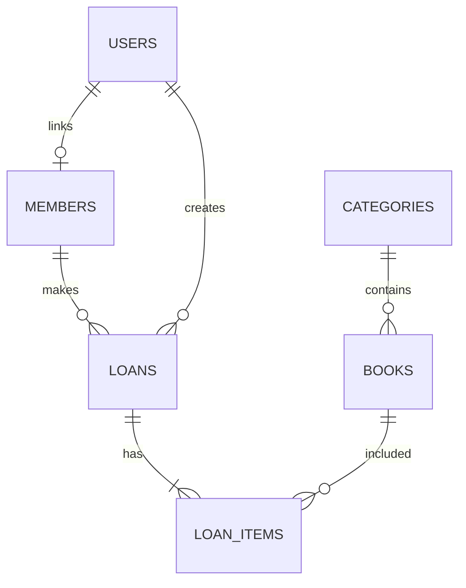

# 4. Rancangan Database MySQL

## Konvensi

- Nama tabel dan kolom menggunakan `snake_case`.
- Primary key menggunakan `id` unsigned big integer.
- Foreign key menggunakan pola `<table>_id`.
- Gunakan `timestamps()` dan `softDeletes()` untuk master yang sudah dipakai transaksi.
- Status disimpan sebagai string yang divalidasi aplikasi.
- Nominal denda menggunakan `decimal(12, 2)`.

## Tabel inti

### `users`

Tabel autentikasi Laravel dengan tambahan `role` (`admin`, `officer`, `student`) dan `is_active`.

### `categories`

`id`, `name` unik, `description`, `created_at`, `updated_at`, `deleted_at`.

### `books`

| Kolom | Tipe | Keterangan |
|---|---|---|
| id | bigint | Primary key |
| category_id | bigint | Foreign key ke categories |
| code | varchar(50) | Kode inventaris, unik |
| isbn | varchar(30) nullable | ISBN |
| title | varchar(255) | Judul |
| author | varchar(150) | Penulis |
| publisher | varchar(150) nullable | Penerbit |
| published_year | smallint nullable | Tahun terbit |
| stock_total | unsigned integer | Semua stok |
| stock_available | unsigned integer | Stok tersedia |
| description | text nullable | Catatan |
| timestamps, deleted_at | - | Audit dan soft delete |

### `members`

`id`, `user_id` nullable, `member_code` unik, `name`, `type`, `class_name` nullable, `phone` nullable, `email` nullable, `is_active`, timestamps, `deleted_at`.

### `loans`

`id`, `member_id`, `user_id` petugas, `loan_number` unik, `loan_date`, `due_date`, `status`, `notes` nullable, timestamps.

### `loan_items`

`id`, `loan_id`, `book_id`, `returned_at` nullable, `status`, `fine_amount` decimal, `notes` nullable, timestamps. Tambahkan unique index pada pasangan `loan_id` dan `book_id`.

### `settings`

`id`, `key` unik, `value`, timestamps. Contoh key: `loan_duration_days`, `fine_per_day`, `max_books_per_loan`.

## Relasi



## Contoh migration manual

Posisi file: `database/migrations/YYYY_MM_DD_HHMMSS_create_books_table.php`

```php
<?php

use Illuminate\Database\Migrations\Migration;
use Illuminate\Database\Schema\Blueprint;
use Illuminate\Support\Facades\Schema;

return new class extends Migration
{
    public function up(): void
    {
        Schema::create('books', function (Blueprint $table) {
            $table->id();
            $table->foreignId('category_id')->constrained()->restrictOnDelete();
            $table->string('code', 50)->unique();
            $table->string('isbn', 30)->nullable();
            $table->string('title');
            $table->string('author', 150);
            $table->string('publisher', 150)->nullable();
            $table->unsignedSmallInteger('published_year')->nullable();
            $table->unsignedInteger('stock_total')->default(0);
            $table->unsignedInteger('stock_available')->default(0);
            $table->text('description')->nullable();
            $table->timestamps();
            $table->softDeletes();
        });
    }

    public function down(): void
    {
        Schema::dropIfExists('books');
    }
};
```

## Integritas data

- Gunakan foreign key dan index pada nomor transaksi, kode buku, kode anggota, judul, dan tanggal.
- Gunakan `DB::transaction()` untuk peminjaman dan pengembalian.
- Jangan mengubah stok langsung dari halaman tanpa validasi service.
- Gunakan eager loading untuk mencegah N+1 query.
